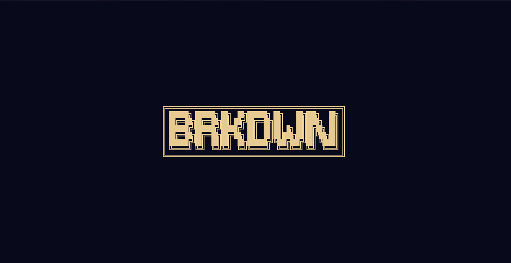

<strong>

BRKDWN
 

 
Tartu Ülikooli LTAT.03.001 põhine projekt.
</strong>

### ARENDAMIS STACK:
Projekt on peaaegu 100% kirjutatud Python programmerimiskeeles. Kasutajaliideseks on `textual` raamistik. Ning `textual` põhist kasutaja liidese välimust kirjeldatakse `.tcss` formaadis. Testid rakendame `pytest` tööriistaga. Andmebaasi jaoks on olemas `sqlite3`.
 
### FEATURES:
- Importeeri oma väljavõtet csv formaadis erinevatest pankadest.
- Vaata oma sissetulukute ja kulude jaotust.
- Ekspordi üldväljavõtet edasiseks haldamiseks csv failina.

### TOETATAVAD PANGAD:
- Swedbank
- LHV
- Revolut

#### ARENDAJAD:
- Konstantin Razdolski 🪤🍻
- Ain August Talts 😔